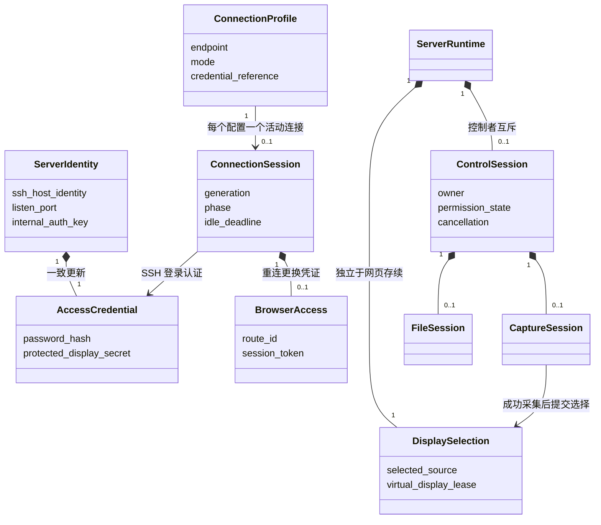
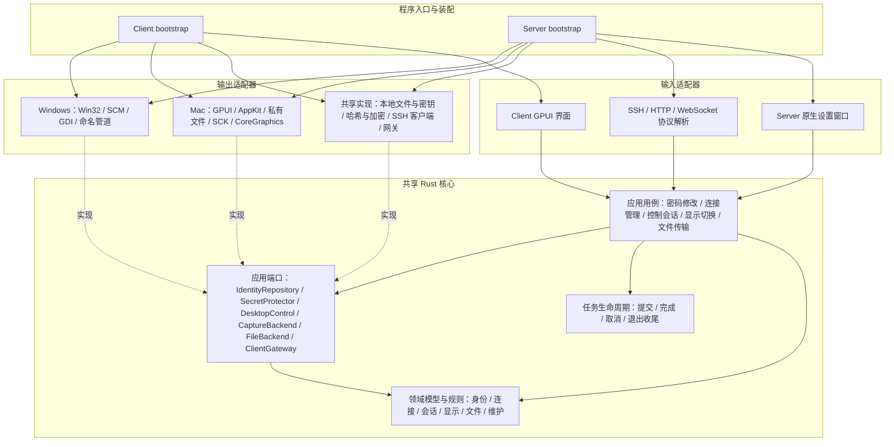
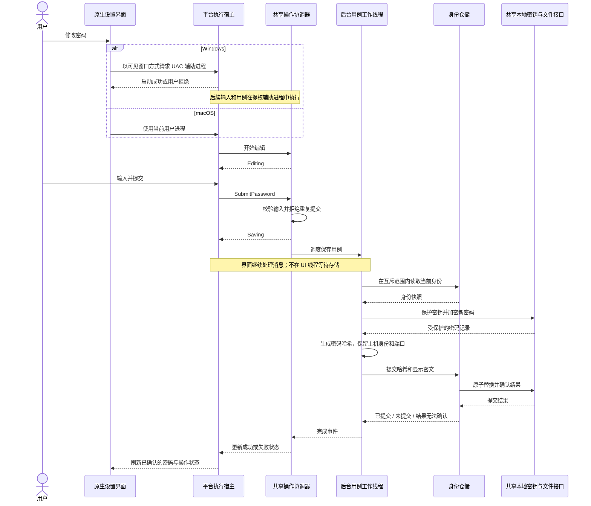
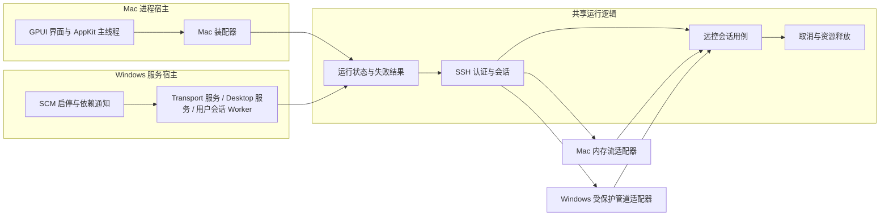

# LanDesk 架构设计

本文是 Client、Server、平台实现及虚拟显示器的统一设计与运维说明。网络入口只有远端 SSH 与客户端本机网页两类；服务端内部不监听 TCP。不提供旧端口转发兼容路径。

## 领域架构（当前实现）

2026-10-16 已将代码整理为一个 workspace、一个锁文件、四个包：`landesk-core`、`landesk`（Server）、`landesk-client`。共享规则和用例在核心中实现，原生接口按目标平台编译。没有旧目录转发、跨目录源码引用或单连接配置迁移路径。本文中的图按职责表达；具体 Rust 类型和文件见下表。

### 实现映射

| 领域 / 边界 | 当前实现 | 约束 |
|---|---|---|
| 身份 | `core/domain/identity.rs::ServerIdentity` | 密码哈希与显示密文一起更新，主机私钥、内部密钥和端口保持不变 |
| 身份用例与存储 | `core/application/password.rs` → `IdentityRepository` / `SecretProtector` → Server `adapters/identity.rs` / `storage::LocalSecrets` | SSH 不负责文件替换；本地密钥文件不进入领域模型 |
| 密码操作 | `core/application/operation.rs::Operation` / `Refresh` | 单个有所有者的写任务；刷新可合并、过期结果丢弃；不强制中止已提交的系统操作 |
| 客户端连接 | `core/domain/connection.rs::ConnectionProfile`、`core/application/connections.rs::ConnectionManager` | 网关与 SSH 由 `ClientGatewayFactory` / `ClientGateway` 注入；保留连接代次和取消规则 |
| 网页空闲 | `core/application/viewer.rs` | 只有最后一个 WebSocket 关闭才开始 30 秒空闲计时 |
| 远控会话 | `core/application/control.rs::ControlSession` | 竞争控制权，显式权限检查；释放前排队恢复输入 |
| 显示、采集、文件 | `core/application/{display,capture,file_worker}.rs`、`core/domain/commands.rs` | 成功采集后提交显示选择；工作线程背压、取消和迟到结果隔离 |
| 维护 | `core/application/maintenance.rs::Transaction` | 按逆序补偿，汇总所有恢复错误；SCM、安装器和驱动策略留在 Windows 宿主 |
| 协议 | `core/protocol/`、Server `adapters/{ssh,web}.rs`、Client `adapters/` | 类型契约共享；网络库及具体传输只在适配器使用 |

表中的 `core/` 指 `crates/core/src/`；应用目录分别是 `apps/server/src/` 和 `apps/client/src/`。没有为了形式统一再包一层巨型 `Platform` 或空的 `ServiceHost` 接口。

### 领域划分与不变量

下列名称表示领域职责；不是要求每个职责单独建一个 crate、进程或数据库表。

| 领域 | 主要对象 | 必须共享的规则 | 平台负责的差异 |
|---|---|---|---|
| 服务端身份 | `ServerIdentity`、`AccessCredential` | 改密码不改 SSH 主机身份、监听端口或内部密钥；哈希与显示密文一致提交 | 共享密钥文件、文件权限、提权 |
| 客户端连接 | `ConnectionProfile`、`ConnectionSession` | 规范化地址、去重、登录认证、连接状态、重连编号、空闲关闭 | 打开浏览器、凭据系统、窗口生命周期 |
| 远控会话 | `ControlSession`、`InputCommand` | 认证先于控制；单控制者；取消后拒绝迟到输入；结束释放按键 | 输入注入、剪贴板、系统权限、安全桌面 |
| 显示与采集 | `DisplaySelection`、`DisplaySpec`、`CaptureSession` | 尺寸预算、虚拟屏复用、采集成功后提交选择、失败保留旧屏 | SCK / GDI、虚拟显示驱动、原生对象线程归属 |
| 文件传输 | `FileSession`、`Upload`、`FileEntry` | 会话隔离、边界校验、分块、提交与取消、错误可见 | 用户目录、路径与链接语义、文件访问身份 |
| 维护与诊断 | `MaintenanceOperation`、`ServiceState`、`DiagnosticReport` | 操作互斥、步骤与补偿、失败汇总、诊断脱敏 | Windows SCM/UAC/驱动；Mac 进程宿主与打包 |

必须保留的产品边界：Server 身份不等于系统登录账户；Client 保存的远端凭据不等于 Server 的本机密钥；Server 的运行状态不等于设置窗口是否打开；“编译了某能力”不等于当前设备有权限使用该能力。



图中对象关系是职责分配，不是数据库表。Client 通过 SSH 加密连接和密码或私钥登录认证访问目标，不保存或校验服务器主机密钥，不取得 Server 的私钥或内部密钥。仍采用当前需要的文件和系统凭据存储，不为领域建模引入数据库、服务拆分或通用事件总线。

### 分层及依赖方向

下图实线表示编译依赖，虚线表示实现接口。端口就是应用层声明的窄接口，不是网络端口。系统适配器依赖这些接口，领域层不依赖系统适配器。



装配图同时展示两个目标平台，实际二进制只编入对应平台的实现。Client 不因引用共享核心而引入服务端驱动或采集依赖。

依赖约束：

1. 领域层只处理值、状态转换和不变量，不读取文件、不访问钥匙串、不调用 UI，也不依赖 Tokio、Hyper、russh 或原生句柄。
2. 应用层负责用例、任务所有权和错误语义，可以使用异步运行时，但只能通过端口调用外部能力；不出现按操作系统分支的业务流程。
3. UI 只收集输入、派发命令、渲染状态。协议适配器只负责解析、校验消息格式和转换，不直接修改身份文件。
4. 平台适配器可以返回不支持、拒绝、不可用等明确结果；不得用空成功、自动换来源或默认放行掩盖缺失能力。
5. 不建立包含所有功能的巨型 `Platform` trait。按用例拆接口，不强迫 Mac 实现 SCM，也不强迫 Windows 实现一个没有授权用户身份的文件后端。
6. 原生句柄及 `!Send` 对象留在所属线程，跨线程传递普通 Rust 命令和结果。UI 不为“共享”而转入工作线程，阻塞存储也不为方便而留在 UI 线程。

### 密码修改：共享流程，平台保留权限边界

共同用例为：验证请求 → 取得操作互斥 → 读取当前身份 → 保护新密码 → 生成哈希 → 原子提交 → 发布结果。UI 的输入草稿、生成预览和取消不修改已保存密码；“随机更换”作为另一个命令提交生成后的密码，两者使用同一保存用例。

Windows 在经过 UAC 的辅助进程内写入服务配置；Mac 在当前用户进程内操作。Windows 密码读取沿用限制本机交互用户的命名管道，由服务端解密后发送显示密码，不向界面开放服务端密钥目录。 这两个进程中的业务用例使用同一份核心代码。原生输入框、UAC 启动和运行循环分别是平台实现。



应用状态与失败处理：

| 状态或事件 | 统一处理 |
|---|---|
| 手工编辑 | 只修改草稿；不占维护锁；刷新按钮生成并保存新密码 |
| 输入校验失败 | 留在编辑状态并说明错误，不启动保存 |
| 保存中 | 禁止重复提交；继续处理窗口消息；退出等待当前提交完成 |
| 放弃草稿或拒绝本次密码操作的 UAC | 结束操作，不显示未知故障、不写配置 |
| 提交前失败 | 已保存身份不变，显示明确错误；释放任务和操作互斥 |
| 已提交但备份清理失败 | 报告“已保存但清理失败”，不把新密码误当未保存；依据实际存储刷新 |
| 提交结果无法确认 | 不宣称保存成功；Windows 异步读回并核验，Mac 保留草稿并报错，重新打开应用时读取核验 |
| 完成事件迟到 | 写任务结果消费前不接纳下一次提交；刷新任务失效后丢弃其结果。连接事件仍以递增编号过滤 |

不能强行取消已经进入文件提交的系统调用，也不能在超时后宣称“保存已取消”。工作任务必须有所有者；不使用无人等待的后台线程悄悄修改密码。结果区分阶段和是否已提交；错误展示及诊断不得包含密码、密钥或输入内容。

两端共用 GPUI Kit 0.7.1 的 `settings_view`：端口与密码行内输入，密码右侧为刷新图标和保存按钮，底部固定一行状态栏。刷新生成并保存新密码，成功后才更新输入框；手工输入需点击保存；刷新不会提交未保存的端口草稿。保存、服务维护在 `Operation` 工作线程执行，操作中禁用重复提交，旧 `Refresh` 读取不能覆盖新状态。

Windows 使用**保存后重启生效**语义。保存只原子提交端口、密码散列和密文；运行中的 SSH 使用启动配置快照，现有远程连接、新连接的旧密码及当前监听端口均不改变。状态栏显示“已保存，下次重启后生效”。防火墙仍限定程序路径与 TCP 端口：保存时允许当前运行端口与待生效端口，提交前失败恢复旧规则；未知提交结果明确报错。这样 Windows 重启也能启用新端口；界面主动重启时规则收敛至已保存端口。

窗口只列出通信服务、桌面服务及 SCM 状态，不提供逐服务控制。底部“重启”依次停止桌面、停止通信，再启动通信、桌面；当前远程连接断开，之后使用新端口和密码连接。尚未保存的输入不参与重启。启动失败仍可从辅助进程返回的加密设置快照编辑端口和密码，避免因服务未启动而无法修正配置。运行中可从 LocalService 所有的本机管道读取已保存设置及是否待生效；新建管理进程仅启动缺少的服务，托盘打开窗口不重启后台。

Mac 保持现有运行方式：密码保存后用于新连接；修改端口时预占新端口，提交后切换监听并断开已有会话。Mac 授权按钮右侧用勾表示授权，事件覆盖显示在共享状态栏。Windows 的服务管理不映射为 Mac 的两个系统服务。

Windows 管理请求及临时密钥位于 `data/server/runtime/ui/request-*/`，不再写系统临时目录。主进程只向管理员辅助进程传路径；加密保存请求不出现在命令行或日志中。每项操作返回结构化结果与覆盖式进度，无密码输入和完成弹窗。维护任务串行执行，系统 UAC 仍可能出现。卸载助手只向请求目录所有者追加 `SYNCHRONIZE` 权限，供普通界面观察退出，不授予结束进程、复制句柄或读写内存权限；使用另一管理员账号授权时也不依赖默认进程 ACL。依据：[Windows 进程访问权限](https://learn.microsoft.com/en-us/windows/win32/procthread/process-security-and-access-rights)、[SetEntriesInAclW](https://learn.microsoft.com/en-us/windows/win32/api/aclapi/nf-aclapi-setentriesinaclw)。

仓储使用独立的 `config.lock` 文件取得非阻塞操作锁，不锁即将被替换的配置文件，进程结束后由操作系统释放锁。Windows 原子替换失败后核验旧配置字节，无法核验时返回 `Unknown`；替换成功但备份清理失败返回 `CommittedWithWarning`。Unix 替换后同步父目录，失败时明确报告已替换但持久化存在问题。依据：[Rust File::try_lock（1.89 起可用）](https://doc.rust-lang.org/std/fs/struct.File.html#method.try_lock)、[Windows ReplaceFileW 失败语义](https://learn.microsoft.com/en-us/windows/win32/api/winbase/nf-winbase-replacefilew)。项目最低 Rust 版本为 1.92。

不调用 Windows 凭据管理器、DPAPI 或 Mac 钥匙串，不迁移旧用户目录和旧凭据。两端共用 `landesk-storage::LocalSecrets`：随机 256 位密钥保存到独立文件，密码使用共享 AES-256-GCM 加解密；读取时缺失或损坏密钥直接报错，不能重新生成后覆盖原密文。密钥与密文同时被读取即可解密；Mac 使用 0700/0600，Windows 继承父目录 ACL，服务端安装器为身份与密钥目录授予 SYSTEM、管理员写入及 LocalService 读取权限。

所有持久数据以实际程序位置为锚点，不取进程当前工作目录：

```text
程序目录/                          # Windows .exe 旁 / Mac .app 包外
  data/
    server/config/config.json
    server/config/keys/         # 每个用途独立随机密钥
    server/logs/                   # Windows 服务和界面日志
    server/preferences.json       # Windows 托盘偏好
    server/runtime/ui/            # 按用户隔离的临时加密管理请求
    server/runtime/setup/         # 安装包展开、卸载助手
    server/display/               # LanDesk 新建驱动的配置
    server/diagnostics/            # 仅命令行诊断导出
    client/settings.json
    client/credentials/            # AES-GCM 密文
    client/credentials/keys/
```

目录不可写时明确报错，不切换到用户目录。移动数据时必须保留对应密钥；Windows 注册服务后移动程序需要重新安装服务。SQLite 不引入：当前数据量小，现有文件原子提交和回滚足够，数据库也不能替代密钥的访问权限保护。

### 服务生命周期：共享任务所有权，保留宿主职责

共享核心分别拥有连接阶段、控制会话租约、采集/文件任务和保存任务；`Shared` 保存当前进程的控制占用、停止信号和显示选择。Windows SCM 状态由 Windows 服务宿主维护，不再复制一份通用服务状态机与 SCM 相互同步。Mac 入口负责 UI、SSH 和内存后端的装配与退出；Windows 入口负责服务依赖及交互工作进程。



这个图不表示把 Windows 多进程改成一个进程：LocalService、LocalSystem 和活动用户会话的边界继续存在。跨进程只能通过经过认证的命令、响应和状态快照协作，不能把内存中的同一个状态对象当作全局服务状态。

当前 Mac 关闭服务窗口会退出 Server；Windows 关闭设置窗口不停止服务。这是运行宿主与产品行为的差异，不能在“统一关闭窗口”函数中隐式改变。共享的是停止用例及其清理规则，由入口决定何时发出停止命令。

### Rust 包布局与条件编译

当前使用一个 Cargo workspace、一个锁文件、四个包。核心内部按领域分模块，不为每个小模型创建 crate。

```text
Cargo.toml                         # workspace 与统一构建 profile
Cargo.lock
crates/core/src/
  domain/                          # 身份、连接配置、密码规则、桌面/显示/文件命令
  application/                     # 密码、操作任务、连接、控制、采集、文件、显示、补偿
  ports/                           # 身份仓储、密钥保护、桌面、采集、文件、客户端网关
  protocol/                        # 共享协议常量和消息契约
  security/                        # AES-GCM、Secret 值、内部认证；无系统密钥 API
crates/storage/src/                # 共用程序旁 data 路径、本地密钥、文件权限与同步
apps/server/src/
  bootstrap/macos.rs               # Mac 进程装配及退出
  adapters/identity.rs             # 身份编码、存储、原子替换
  adapters/ssh.rs                  # russh 入站协议适配
  adapters/web.rs                  # HTTP/WebSocket 解析、转发与背压
  platform/macos/                  # GPUI 设置界面、AppKit、SCK、输入、文件、虚拟屏
  platform/windows/                # SCM、UAC、管道、GDI、输入、驱动、原生窗口
  setup.rs / diagnostics.rs        # 安装配置校验、诊断格式与日志落盘
apps/client/src/
  main.rs / ui.rs                  # 入口、GPUI 共享界面及装配
  adapters/                       # 网关、SSH、终端/SFTP、配置/凭据事务
  adapters/credentials/            # 两端共用 AES-GCM 凭据文件与事务
  platform/                       # 按平台编译 Mac 窗口 / Windows 托盘
web/                              # 桌面及通用网页资源
apps/client/web/                  # 终端网页资源
docs/architecture.md
```

共享核心不能依赖 Server 或 Client；协议适配器依赖核心中的消息契约，领域模型不能反过来依赖网络消息。模块边界由最小可见性和架构检查约束，crate 边界确保共享核心不引入 GUI、驱动或系统 SDK。`landesk-storage` 是共享存储适配器，依赖 core；core 不反向依赖它。客户端凭据事务与服务端身份事务各自保持独立。

Rust 的条件编译可排除不适用的模块，Cargo 可按目标平台选择依赖；这是项目已经使用的机制，不需要自制平台探测器。下面是已使用的模块选择方式：

```rust
#[cfg(target_os = "macos")]
mod macos;
#[cfg(target_os = "windows")]
mod windows;
```

```toml
[target.'cfg(target_os = "macos")'.dependencies]
objc2-app-kit = "=0.3.2"

[target.'cfg(target_os = "windows")'.dependencies]
windows-sys = "=0.61.2"
```

实际 manifest 还需声明所用 API 的 features。共享用例不出现 `if cfg!(windows)` 来选择两套流程；`cfg!` 只是布尔表达式，不能用它代替 `#[cfg]` 排除另一平台无法编译的代码。`features` 用于可选产品能力，不用于伪装操作系统，也不能代表用户已授权。

两端已统一 `objc2 = 0.6.5`，保留 GPUI Kit 0.7.1、ScreenCaptureKit 11.0.0、AppKit/Foundation 0.3.2。Mac arm64 全目标编译和 Clippy 已通过；Mac Intel 尚未验证。Windows 使用独立的原生实现及目标依赖，具体验证记录见文末。

依据：[Rust 条件编译](https://doc.rust-lang.org/reference/conditional-compilation.html)、[Cargo 平台依赖](https://doc.rust-lang.org/cargo/reference/specifying-dependencies.html#platform-specific-dependencies)、[Cargo workspace](https://doc.rust-lang.org/cargo/reference/workspaces.html)。当前项目声明 Rust 最低版本 1.92；条件编译沿用 `#[cfg]` 和目标依赖机制。

### 验收边界

workspace、身份仓储、共享密码用例、后台操作、连接/控制生命周期及维护补偿已完成代码重构。架构检查脚本 `scripts/check_architecture.py` 禁止核心引用 GUI、网络适配器、原生 SDK，禁止领域模块调用 IO 或反向依赖应用层，并检查应用不存在独立锁文件和跨目录源码引用；两个 Windows 工作流均执行该检查。

| 验证层 | 必须证明 |
|---|---|
| 领域测试 | 密码规则、连接代次、控制者互斥、显示提交、上传状态等不变量不依赖 OS |
| 应用用例测试 | 注入慢存储、拒绝权限、提交失败、提交后清理失败、迟到完成、重复点击和退出；UI 调用不等待阻塞操作 |
| 仓储契约测试 | 哈希与显示密文一致；密码更新不修改主机身份；失败结果与磁盘状态一致；不得静默重建密钥 |
| 平台编译与静态检查 | Mac / Windows 各自目标依赖正确；共享核心没有原生 SDK 依赖；禁止平台适配器被领域模块反向引用 |
| Windows 原生测试 | 首个提权辅助窗口可见、可关闭；父窗口消息循环持续推进；SCM/管道身份验证仍生效 |
| Mac 原生测试 | 已有主线程运行循环测试；新增密码窗口和真实系统密钥存储交互仍需实机验收 |
| 协议集成 | 真实 Client → SSH → Server → HTTP/WebSocket；错误凭证、取消、重连和断开隔离 |
| 实机验收 | Windows A 控制 Mac B，同时 B 控制 Windows C；Windows 保存后旧端口/密码保持有效，重启后切换新端口/密码；Mac 保存后新连接使用新密码 |

条件编译检查、单元测试和 Windows CI 原生窗口测试不能替代 UAC 安全桌面、TCC、硬件采集或三机链路实测。共享接口也不意味着所有平台功能齐全：当前 Windows 桌面文件访问明确禁用，不能因统一 `FilePort` 就开放 SYSTEM 文件系统。

## 角色与连接拓扑

Client 负责连接配置、凭据、本机网页入口和出站 SSH；Server 负责入站 SSH 认证、屏幕、键鼠、剪贴板和文件访问。两个程序独立运行，不互相启动、停止或持有安装锁。

```text
Windows A 浏览器 → A 的 Client → SSH → Mac B 的 Server
Mac B 浏览器     → B 的 Client → SSH → Windows C 的 Server
```

Mac B 可以同时被控并控制其他设备。退出 B 的 Client 只结束第二条链路；关闭 B 的 Server 才会影响第一条链路。嵌套浏览器远控会叠加画面压缩与延迟，不是透明跳板。SSH 跳板、中继、NAT 穿透尚未实现，目标地址必须可达。

| 边界 | 实现 | 配置 |
|---|---|---|
| Client 到 Server | SSH，默认 `2222`，可配置；桌面模式使用 `landesk` subsystem | 目标地址、SSH 端口、连接密码 |
| 浏览器到 Client | `127.0.0.1:0` 由系统分配端口；一个 Client 实例一个入口 | 无需用户配置；实际地址只在运行时保存 |
| Mac Server 内部 | 有界内存双向流承载 HTTP/WebSocket | 无 TCP 端口 |
| Windows Server 内部 | 受保护的本机命名管道 | 禁止远程管道客户端；验证 SYSTEM 所有者及内部密钥 |

桌面服务只接受专用 subsystem，不提供系统账户登录、Shell、任意 TCP 转发或远端端口转发。SSH 终端模式是 Client 的独立功能，连接普通 SSH 服务的 PTY/Shell/SFTP，使用该 SSH 账户权限，不依赖 LanDeskServer。

## 连接与安全边界

1. Client 启动本机动态网页入口，记录实际监听地址。配置文件不保存这个端口。
2. 连接目标并完成 SSH 登录认证；不保存或校验 SSH 主机密钥，密钥变化不阻止连接。连接密码留在本机凭据存储和 SSH 认证流程中，不进入网页。
3. 桌面模式打开 SSH session channel，请求 `landesk` subsystem，并等待明确的成功回执；拒绝、超时或后端不可用时不发布就绪状态。
4. 就绪连接注册 `/s/<连接ID>/` 路由，同时生成独立随机 256 位网页访问凭证。连接 ID 来自目标地址和端口的 SHA-256，仅用于路由，不是凭据。
5. Client 打开的 URL 在查询参数中携带启动凭证；网关验证后返回 303，跳到不含凭证的页面地址，并设置按端口命名、按连接路径限定的 `HttpOnly; SameSite=Strict` 会话 Cookie。入口和页面均禁止缓存，设置 `Referrer-Policy: no-referrer`。启动 URL 是敏感信息，不应复制分享或写入日志；本机浏览器历史、同账户恶意进程不属于该机制能完全隔离的范围。
6. 每次资源请求与 WebSocket 升级都校验实际 Host 和凭证；提供 Origin 时必须精确匹配实际入口，WebSocket 必须携带 Origin。其他本机端口、外部站点、缺失或失效凭证均不能访问会话。
7. 网关移除浏览器 Cookie，将已验证的请求转换为内部 HTTP 身份 `landesk.internal`。Server 的 SSH 边界覆盖外来内部认证头，注入本机私有密钥；资源与 WebSocket 统一验证该密钥。Windows 管道访问限制保持独立有效。

内部 HTTP 身份是协议常量，不解析 DNS、不监听端口，不代表远端设备身份。连接密码用于服务器验证客户端；主机密钥仍参与 SSH 握手，但客户端不验证它与目标设备的绑定。终端页面另有每会话 hello token；来源、网页凭据及终端初始化认证分别验证。

同一 Client 的目标页面共享浏览器同源，路径和 Cookie 不构成目标网页之间的隔离；应只连接可信服务器。主机密钥校验已移除，客户端不能识别冒充的服务器。

断开立即取消通道与转发任务，路由注销后凭证失效。同一目标重连生成新凭证，旧 Cookie、旧启动 URL 不可复用。客户端重新连接后自动打开新 URL；不能靠刷新旧地址创建 SSH。

## 生命周期与故障范围

`ConnectionManager` 拥有网页入口、SSH 任务、取消信号和连接状态。每次连接使用递增编号，旧任务迟到事件不能覆盖新连接；网页入口重启也使用独立编号，旧入口退出事件不能破坏新入口。

连接状态为连接中、已连接、断开中、已停止；同一目标的任务未结束前不能再次连接。多个目标共享网页监听器，各自拥有 SSH、路由、凭证、任务和空闲计时。断开一个目标不影响其他目标。

- 网页入口启动/运行失败：阻止新连接，停止依赖它的会话，显示错误和重试入口；配置添加、编辑和保存仍可用。旧连接清理完后可重启入口。
- 配置加载失败：明确报错，阻止覆盖原配置；不能以空配置静默替代并写回。
- 凭据读取/写入失败：报告对应操作错误，不将其当成密码不存在。
- 单目标认证、权限、采集或通道失败：限制在该目标，不关闭其他连接或同机 Server。
- 退出 Client：取消连接、等待任务结束，再关闭本机入口。关闭窗口与退出应用是不同操作。

Windows Client 可选择最小化/关闭窗口留在托盘。Mac Client 不创建菜单栏状态图标：最小化到 Dock，关闭窗口保留连接，Dock 重新打开恢复窗口，应用菜单或 `⌘Q` 断开连接后退出。

SSH 就绪后，连续 30 秒没有桌面/终端 WebSocket 会话则关闭该 SSH；HTTP 保活与资源访问不续期。最后一个网页会话关闭后开始计时，宽限期内刷新可继续使用同一连接。终端打开但不输入不算空闲。网络故障由 TCP/SSH 心跳识别，不按桌面输入或画面频率判断。

## 平台能力与约束

### macOS

使用 ScreenCaptureKit 采集、Enigo/CoreGraphics 输入、GPUI 设置窗口与 AppKit 剪贴板。输入及清理在 AppKit 主线程的 common run-loop modes 中执行，窗口拖动或模态循环不应吞掉按键释放。需要屏幕录制与辅助功能授权；启动不自动申请。

连接密码首次随机生成 8 位数字/大小写字母，界面可直接选中文本复制和编辑。验证使用 Argon2id，显示密码使用 AES-256-GCM 密文；加密密钥保存在 `data/server/config/keys/`；目录权限 `0700`，密钥文件权限 `0600`，不调用钥匙串。密钥与配置都依赖当前用户的文件访问权限保护，不防止同一用户进程读取。保存失败保留输入草稿并在状态栏报错，不显示保存成功。SSH 身份与内部认证密钥不提供给浏览器。

当前 `.app` 打包采用本机 ad-hoc 临时签名，没有 Developer ID 签名或公证；更新后系统可能重新要求隐私授权。正式分发签名尚未接入。

虚拟屏为实验能力，使用未公开的 `CGVirtualDisplay`，不是 Apple 承诺稳定的公开 API；实际采集仍使用 ScreenCaptureKit。运行时检查类和选择器，创建失败明确报错。

### Windows

提供 `LanDeskTransport`（LocalService）与 `LanDeskServer`（LocalSystem）两项服务，桌面服务依赖通信服务。桌面工作进程位于活动控制台会话，通信通过 SYSTEM 所有的受保护命名管道，不通过本机 TCP。托盘/设置界面与后台服务分离，退出管理界面不停止远控。

物理控制台可能与 RDP 会话不同；不自动登录、不修改系统账户或 RDP。支持 GDI/JPEG 采集、SendInput 和剪贴板；桌面文件访问与上传明确禁用，不暴露 LocalSystem 文件系统。普通输入失败时保留画面和选屏，显示警告；实际输入成功后撤销警告，不重放失败点击或文字。Ctrl+Alt+Delete 的 SendSAS 调用无效果回执，日志成功不代表登录界面必然响应。

连接配置位于程序旁 `data/server/config/config.json`，包含 Argon2id、AES-GCM 密文、SSH 身份与内部密钥，限制普通用户读取。密码加密密钥使用共享本地文件方案。专用本机密码管道允许交互用户读取显示密码，拒绝远程客户端；界面校验 LocalService 管道所有者，不接收 SSH 私钥、密码加密密钥或内部密钥。

### 显示选择与虚拟设备生命周期

`hello.display` 与 `set_display_source.display` 使用统一结构：

```json
{"kind":"virtual","width":1920,"height":1080}
```

已有屏幕使用 `{"kind":"existing","id":123}`，`id:null` 为主屏。省略 display 时使用本次服务进程最后成功选择，首次为主屏；采集失败不自动切屏或创建虚拟屏。

虚拟设备由 Server 持有，网页断开/刷新后仍存在；相同尺寸复用。新设备创建及采集初始化成功后才提交选择；失败保留原选择，旧采集释放后再处理旧设备。切回实体屏仍保留最后虚拟屏到服务退出，配置不落盘。尺寸受 1600 万像素预算限制。创建显示器可能触发系统调整布局，但 LanDesk 不主动搬窗口、镜像或改变主屏。

Windows 驱动使用上游 MttVDD 25.7.23 原始 DLL/INF/CAT，安装前核验 SHA-256 和 WinVerifyTrust，再由 DiInstallDevice 验证安装；不导入证书或开启测试签名。新配置为 1920×1080、60 Hz、SDR；自建设备 `ROOT\LANDESKDISPLAY\0000`。已有正常 MttVDD 复用并保留配置及归属；设备异常或配置无效时明确失败。新建驱动的配置位于 `data/server/display/vdd_settings.xml`，通过注册表 `HKLM\SOFTWARE\MikeTheTech\VirtualDisplayDriver\VDDPATH` 指定；安装失败回滚路径登记和本次配置。已核对 [25.7.23 Driver.cpp 的 initpath/loadSettings](https://github.com/VirtualDrivers/Virtual-Display-Driver/blob/25.7.23/Virtual%20Display%20Driver%20%28HDR%29/MttVDD/Driver.cpp)：支持 REG_SZ 自定义路径，读取缓冲区受 MAX_PATH 限制。Windows Driver Store 仍由系统管理，不能迁入应用目录；复用其他程序已有驱动时保留其原配置路径。

无头冷启动、合盖、FileVault、UAC、锁屏和不同系统版本的能力必须逐项实机验证，不能由编译成功或显示器枚举成功推出。Linux 图形桌面服务、音频与透明跳板尚未实现。

## Windows 安装、维护与诊断

双击 `LanDeskServer.exe`，管理员授权后完成安装；驱动与模板内嵌，无需系统 OpenSSH、PowerShell 或维护脚本。防火墙规则仅放行指定服务端程序的 SSH 入站端口。驱动提示重启时需重启后验收。

安装器只有全新安装路径：校验归属，清理被替换的服务/程序/连接配置，再创建服务与入口。更新会生成新密码和 SSH 身份；正常运行及重启保留它们。无关文件、共享驱动和已有显示配置必须保留，同名但归属不明的程序拒绝覆盖。安装失败逆序回滚本次创建对象并记录回滚失败；不承诺恢复已经清理的旧服务。

- 托盘菜单提供“开机启动”“最小化托盘”，勾选后立即保存，失败恢复原选项及系统设置。两项均启用时，登录启动直接创建隐藏窗口，不先显示再隐藏；手动启动或托盘打开设置会显示窗口。
- 取消开机启动只改变后续启动方式，不断开当前连接；关闭设置窗口是否隐藏到托盘由“最小化托盘”决定，退出托盘不停止后台。
- 窗口右下角“重启”“卸载”，上方两行只显示服务状态；启停阶段和查询失败分别显示“启动中/停止中”和“未知”，不把错误当停止。
- 卸载在主窗口确认一次，停止服务、移除系统入口和 LanDesk 自建虚拟设备，保留配置、日志、第三方设备及共享 Driver Store 包。辅助进程将过程写到状态栏；最后通知窗口退出以释放 EXE，再删除程序文件。窗口退出后的最终结果写入 `uninstall.log`；运行中的卸载助手登记下次 Windows 重启清理。
- 界面移除复制密码、旧密码操作按钮、导出日志、修复并启动和单独保存启动设置。日志自动写入程序旁 `data/server/logs/`；启动路径检查必要目录和日志文件，不重建缺失的身份和密钥。命令行 `--export-logs` 仍可导出不含凭据的诊断包。

只读检查：

```text
LanDeskServer.exe --version
LanDeskServer.exe --status
```

后台日志：`install.log`、`uninstall.log`、`server.log`、`transport.log`、`worker.log`；带 UTC 时间、PID、版本，约 2 MB 轮换。界面日志为同目录 `ui.log`。诊断只收集明确列出的日志、服务、设备与会话元数据，不收集密码、配置、私钥、画面、输入、剪贴板或窗口标题。首帧日志只记录是否纯色，不记录像素。

服务先注册 SCM 再初始化日志；初始化失败通过 SCM 报错。主窗口卸载确认不占维护锁；维护辅助进程在后台线程等待，GPUI 继续处理窗口消息。

维护辅助进程以 `SW_SHOWNORMAL` 启动，并通过 `SEE_MASK_NO_CONSOLE` 避免新建控制台。不能使用 `SW_HIDE` 隐藏控制台：Windows 会将启动显示参数应用到第一次 `ShowWindow`，导致密码窗口隐藏、主窗口一直等待用户完成不可见的对话框。原生回归测试通过实际提权启动路径，在新进程中检查首次窗口可见及可关闭；不改密码或安装状态。依据：[ShowWindow 启动参数规则](https://learn.microsoft.com/en-us/windows/win32/api/winuser/nf-winuser-showwindow)、[ShellExecuteEx 参数](https://learn.microsoft.com/en-us/windows/win32/api/shellapi/ns-shellapi-shellexecuteinfow)。

## 构建与验证

```sh
python3 scripts/check_architecture.py
cargo fmt --all --check
cargo test -p landesk-core -p landesk --locked
cargo clippy --workspace --locked --all-targets -- -D warnings
cargo test --manifest-path apps/client/Cargo.toml --locked --no-default-features --lib --tests
cargo clippy --manifest-path apps/client/Cargo.toml --locked --all-targets -- -D warnings
node --test web/*.test.mjs apps/client/web/*.test.mjs
python3 scripts/bundle.py
python3 scripts/bundle_macos_client.py --debug
```

跨程序集成测试使用真实 Client、SSH Server 和内存 HTTP/WebSocket 后端，桌面平台使用测试替身，不采集屏幕或注入输入：

```sh
cargo build --manifest-path apps/client/Cargo.toml --locked --no-default-features --example desktop_probe
LANDESK_CLIENT_PROBE=/absolute/cargo-target/debug/examples/desktop_probe \
  cargo test -p landesk --locked --lib actual_client_crosses_subsystem_memory_backend_and_browser_authentication -- --ignored
```

将环境变量替换为实际 Cargo target 下的可执行文件绝对路径；Windows 工作流已包含这项测试。

Windows 在 MSVC、Windows SDK、CMake 环境构建：

```text
cargo build --locked --release --bin LanDeskServer --bin LanDeskDisplay
python scripts/bundle_windows_display.py --server-exe target/release/LanDeskServer.exe --output target/LanDeskServer-windows-x64
cargo build --manifest-path apps/client/Cargo.toml --locked --release --bin LanDeskClient
```

普通测试不安装驱动、不创建虚拟设备。Windows 管理员原生维护测试由 CI 显式运行：`cargo test -p landesk --locked --lib native_setup_ -- --ignored --test-threads=1`。Mac 真实虚拟显示测试需要显式设置 `LANDESK_TEST_VIRTUAL_DISPLAY=1 LANDESK_TEST_VIRTUAL_CAPTURE=1`，且测试进程已有屏幕录制权限。

按本次改动涉及的产品和平台打包；服务端改动不要求客户端同步升级。Windows 服务端独立包使用 `windows-display.yml`，客户端使用 `windows-client.yml`。共享 `Cargo.lock` 的变动会触发两者，因此明确只发布 Windows 服务端时，提交消息加入 `[skip ci]`，推送后显式执行 `gh workflow run windows-display.yml --ref <已推送分支>`，并核对运行的提交 SHA。工作流会执行服务端、共享库及 Client 探针验证，但仅上传 `LanDeskServer-windows-x64` 包。此流程是显式选择构建目标，不是自动分析依赖影响范围；共享代码变动仍需验证受影响的平台。依据：[跳过 push/PR 自动运行](https://docs.github.com/en/actions/how-tos/manage-workflow-runs/skip-workflow-runs)、[手动运行指定分支的工作流](https://docs.github.com/en/actions/how-tos/manage-workflow-runs/manually-run-a-workflow)。

验收必须覆盖：同机 Client/Server 共存、两条独立链路、旧端口已占用时 Client 可启动、跨目标隔离、网页凭证缺失/错误/失效、错误 Origin/Host、未知 subsystem/Shell/端口转发拒绝、入口失败后配置可编辑及重试、退出释放所有任务。UI 构建与协议测试不等于真实跨机桌面/键鼠验收。

## 版本依据与验证记录

**Server 0.6.0 Windows 管理界面改版，本地验证（2026-10-16，Windows 包待 CI 构建）**：Windows 与 Mac 共用 GPUI 连接输入行和状态栏；Windows 改为保存后重启生效。服务端库测试 45 项通过、1 项现有集成探针测试忽略；新增真实 SSH/WebSocket 测试覆盖保存期间连接继续通信、重启前旧密码有效、重启断开旧连接、新端口/密码启用。Mac 全目标和 Windows x64 gnullvm 交叉全目标 Clippy 通过。尚未验证 Windows 实机 GPUI、托盘隐藏启动、UAC、SCM 重启、卸载及 VDDPATH 驱动加载；交叉检查不代表 Windows MSVC 打包或实机运行通过。

**0.5.0 本地验证（2026-10-16）**：核心 29 项、共享存储 2 项、服务端 44 项库测试通过；客户端 14 项库测试和 7 项 SSH/PTY/SFTP 测试通过。覆盖本地 AES 密文、密钥丢失/损坏、数据目录移动、事务回滚、端口预占及监听切换。Mac arm64 与 Windows x64 gnullvm 全目标 Clippy 通过。Windows MSVC 与原生安装/服务/界面尚未验证。Mac 两个 release 应用已替换到 `/Applications`；已检查 GPUI 布局、无效端口状态栏错误、重启恢复相同密码、`/Applications/data/server/` 实际落盘及 SSH 监听。未通过界面修改真实密码，未验证本轮远程画面和输入；当前新版系统授权显示未授权。

**0.4.0 重构完成时的历史验证（2026-10-16）**：

| 检查 | 结果 |
|---|---|
| 共享核心 | 28 项库测试、3 项采集/虚拟屏契约测试通过 |
| Mac 服务端 | 42 项库测试、1 项真实文件工作线程清理测试通过；原生运行循环的默认、鼠标跟踪及模态模式测试通过 |
| 客户端 | 14 项库测试、7 项真实 SSH/PTY/SFTP 集成测试通过 |
| 跨进程连接 | 真实 Client 探针 → SSH subsystem → Server 内存后端 → 网页认证/WebSocket/断开清理通过；桌面采集和输入使用替身 |
| 网页 | 29 项测试通过 |
| 静态检查 | Mac arm64 和 Windows x64 gnullvm 全 workspace、全部目标（含 GPUI 客户端、服务端、测试及示例）Clippy `-D warnings` 通过 |
| 文档及边界 | 架构依赖检查、格式、UTF-8、Python 语法、本地链接、4 张 Mermaid 图语法及 diff 检查通过 |

以上历史测试不能代替本次存储与界面变更的验证；Windows UAC/SCM/驱动、Mac Intel 和三机链路仍需实机验收，虚拟显示硬件测试默认跳过。


锁定依赖：russh 0.64.1、Tokio 1.53.2、Hyper 1.12.0、Axum 0.8.9、GPUI Kit 0.7.1、ScreenCaptureKit Rust 11.0.0、Enigo 0.6.1、windows-sys 0.61.2、windows 0.61.3。接口先核对本机锁定源码。

- 2026-10-15，0.3.0：Mac 服务端 54 项库测试、3 项平台契约测试及原生运行循环测试通过；客户端 26 项核心测试与 7 项 SSH/终端集成测试通过；29 项网页测试通过。跨程序集成测试验证了 subsystem、内存后端、网页凭证交换、静态资源、WebSocket 升级与断开路由清理；没有验证真实画面或输入。
- 两端格式检查和 Clippy 通过。Windows x64 gnullvm 客户端全目标编译检查、服务端库及两个程序 Clippy 通过；这是 macOS 交叉检查，不等于 Windows MSVC CI 或实机通过。
- Mac arm64 Server 优化构建及 Client 调试构建完成，均采用 ad-hoc 签名。Client 已更新到 `/Applications/LanDeskClient.app` 并验证界面可操作；旧 Server 仍占用 `127.0.0.1:17890` 时，新 Client 使用系统分配的端口正常启动。当前运行的旧 Server 未被替换，新 Server 构建产物尚未实机启动验收。
- 既有实测：Mac 真实画面、键鼠、中文、文件操作、复制/粘贴按钮；Mac 虚拟屏创建、尺寸、复用、释放和真实 JPEG 首帧。用户曾验证 Win10 mini 无实体屏冷启动后通过网页登录、操作主屏与登录后的虚拟副屏。
- 尚未验证：本轮新协议在真实 Windows 设备的部署、三机嵌套完整操作、Mac Intel/旧系统兼容性、Win11/UAC/锁屏全面场景。历史实测不代表本轮版本已通过相同验收。
- 2026-10-16，Server 0.3.1：修复 Windows 修改密码辅助窗口被隐藏的问题；Windows x64 交叉编译和 Clippy 通过。[Windows MSVC CI](https://github.com/dripai/LanDesk/actions/runs/38777656627) 的 30 项库测试、10 项原生维护测试及跨程序集成测试通过，包含实际辅助进程首次窗口可见性测试；发布包已上传。真实设备的 UAC、密码输入和保存仍需验收。此补丁不改变通信协议，配套 Client 仍为 0.3.0。

官方及实现依据：

- [SSH subsystem / russh Handler](https://docs.rs/russh/0.64.1/russh/server/trait.Handler.html)、[Tokio 动态监听](https://docs.rs/tokio/1.53.2/tokio/net/struct.TcpListener.html)、[Tokio 内存流](https://docs.rs/tokio/1.53.2/tokio/io/fn.duplex.html)、[Hyper HTTP Upgrade](https://docs.rs/hyper/1.12.0/hyper/upgrade/index.html)。
- [ScreenCaptureKit](https://developer.apple.com/documentation/screencapturekit)、[AppKit Run Loops](https://developer.apple.com/library/archive/documentation/Cocoa/Conceptual/Multithreading/RunLoopManagement/RunLoopManagement.html)、[Unix 文件权限](https://doc.rust-lang.org/std/os/unix/fs/trait.PermissionsExt.html)、[Developer ID](https://developer.apple.com/developer-id/)。
- [Mac 虚拟显示器参考实现（Chromium）](https://chromium.googlesource.com/chromium/src/+/HEAD/ui/display/mac/test/virtual_display_util_mac.mm)：不是公开 Apple API 承诺。
- [Windows IDD](https://learn.microsoft.com/en-us/windows-hardware/drivers/display/indirect-display-driver-model-overview)、[MttVDD 25.7.23](https://github.com/VirtualDrivers/Virtual-Display-Driver/releases/tag/25.7.23)、[DiInstallDevice](https://learn.microsoft.com/en-us/windows/win32/api/newdev/nf-newdev-diinstalldevice)、[WinVerifyTrust](https://learn.microsoft.com/en-us/windows/win32/api/wintrust/nf-wintrust-winverifytrust)。
- [Windows 服务入口](https://learn.microsoft.com/en-us/windows/win32/api/winsvc/nf-winsvc-startservicectrldispatcherw)、[DeleteService](https://learn.microsoft.com/en-us/windows/win32/api/winsvc/nf-winsvc-deleteservice)、[CreateProcessAsUserW](https://learn.microsoft.com/en-us/windows/win32/api/processthreadsapi/nf-processthreadsapi-createprocessasuserw)、[SendInput](https://learn.microsoft.com/en-us/windows/win32/api/winuser/nf-winuser-sendinput)、[SendSAS](https://learn.microsoft.com/en-us/windows/win32/api/sas/nf-sas-sendsas)。
